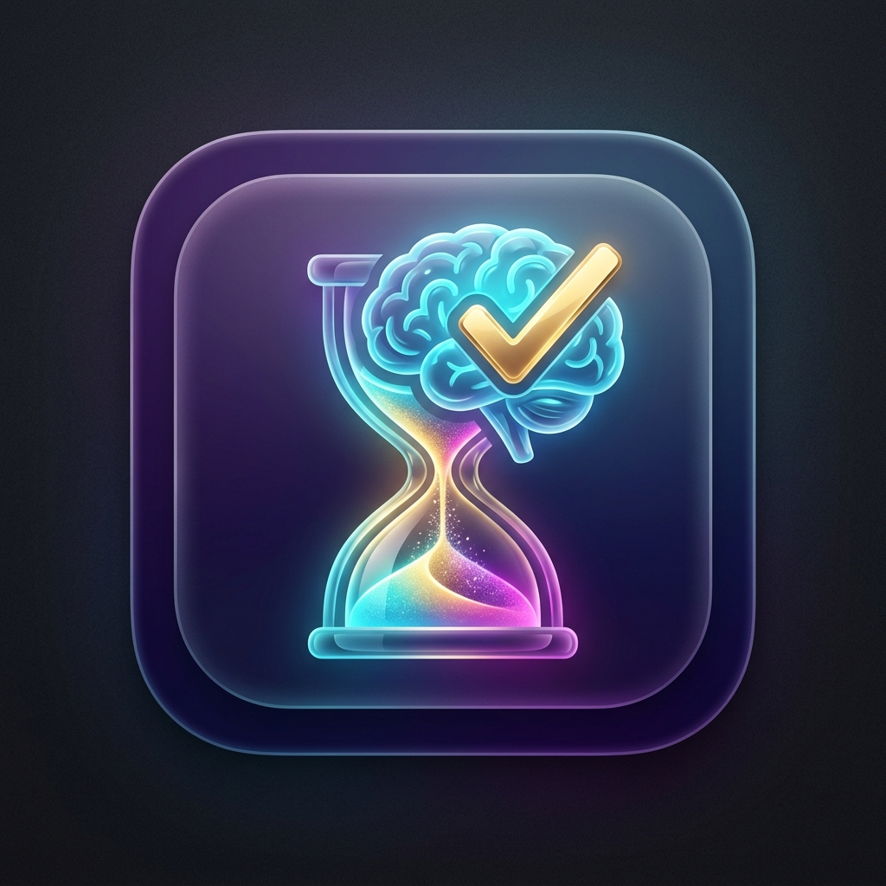
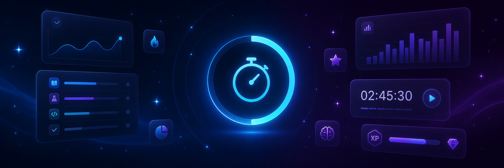
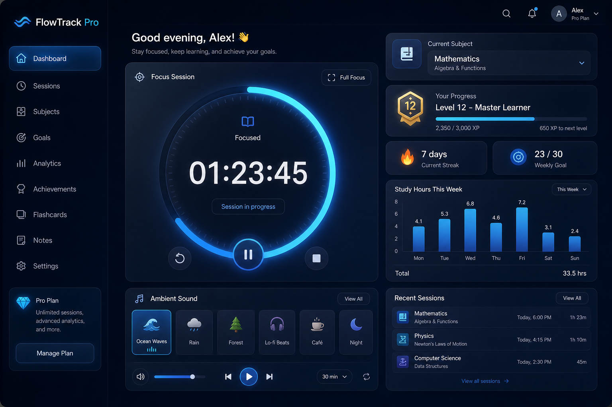

<div align="center">



# 🚀 FlowTrack Pro
### 💎 The Ultimate Master Study & Productivity Ecosystem — 2026 Enterprise Edition

<!-- Dynamic Animated Typing Header -->
<a href="https://github.com/SudhirDevOps1/The-Ultimate-Master-Study-Tracker">
  
</a>

<p align="center">
  <a href="https://github.com/SudhirDevOps1/The-Ultimate-Master-Study-Tracker/releases/latest">
    
  </a>
  <a href="https://the-ultimate-master-study-tracker.vercel.app/">
    
  </a>
  <a href="https://github.com/SudhirDevOps1/The-Ultimate-Master-Study-Tracker/actions/workflows/release.yml">
    
  </a>
  <a href="LICENSE">
    
  </a>
</p>

<!-- DevSecOps & Quality Badges -->
<p align="center">
  <a href="https://github.com/SudhirDevOps1/The-Ultimate-Master-Study-Tracker/actions/workflows/ci.yml">
    
  </a>
  <a href="https://codecov.io/gh/SudhirDevOps1/The-Ultimate-Master-Study-Tracker">
    
  </a>
  <a href="https://securityscorecards.dev/viewer/?uri=github.com/SudhirDevOps1/The-Ultimate-Master-Study-Tracker">
    
  </a>
  <a href="https://github.com/SudhirDevOps1/The-Ultimate-Master-Study-Tracker/actions/workflows/codeql.yml">
    
  </a>
  <a href="https://github.com/SudhirDevOps1/The-Ultimate-Master-Study-Tracker/actions/workflows/gitleaks.yml">
    
  </a>
  <a href="https://coderabbit.ai">
    
  </a>
</p>

<p align="center">
  <a href="https://github.com/SudhirDevOps1/The-Ultimate-Master-Study-Tracker/stargazers">
    
  </a>
  <a href="https://github.com/SudhirDevOps1/The-Ultimate-Master-Study-Tracker/network/members">
    
  </a>
  <a href="https://github.com/SudhirDevOps1/The-Ultimate-Master-Study-Tracker/issues">
    
  </a>
  <a href="https://github.com/SudhirDevOps1/The-Ultimate-Master-Study-Tracker/releases">
    
  </a>
</p>

<!-- Tech Stack -->
<p align="center">
  
  
  
  
  
  
  
</p>



> **The ultra-lightweight, local-first, privacy-respecting productivity & study tracker built for relentless learners.**
> Featuring real-time active application tracking, smart distraction blocker, OCR whiteboard, and cross-platform desktop installers.

### 🌐 [Live Web App](https://the-ultimate-master-study-tracker.vercel.app/) &nbsp;•&nbsp; 📦 [Download Desktop Installer (.exe)](https://github.com/SudhirDevOps1/The-Ultimate-Master-Study-Tracker/releases/latest) &nbsp;•&nbsp; 📖 [Developer Instructions (AGENTS.md)](AGENTS.md)

</div>

---

> [!NOTE]
> **100% Free & Open-Source Community Suite**: FlowTrack Pro is completely free under the permissive MIT license. Architecturally inspired by proven open-source developer tools:
> - **ActivityWatch** — Automated local-first window tracking and OS-level AFK idle detection with zero remote server logging.
> - **Super Productivity** — Ergonomic 20-20-20 eye-care synthesizer, task timeboxing, and developer focus techniques.
> - **Anki / SuperMemo SM-2** — Spaced repetition memory algorithm ($I_n = I_{n-1} \times EF$) for programming syntax, interview problems & concepts.
> - **Dayflow & Wakapi** — Passive screen and IDE project categorization between deep study, coding, and browsing.

---

## 🛡️ Enterprise Auto-Updater & Zero Data Loss Architecture

FlowTrack Pro features an enterprise-grade automated update pipeline engineered to deliver seamless upgrades while guaranteeing **100% zero data loss**:

```
┌────────────────────────────────────────────────────────┐
│               GitHub Release Published (v0.2.4)        │
└──────────────────────────┬─────────────────────────────┘
                           │
                           ▼
┌────────────────────────────────────────────────────────┐
│       Electron Background Auto-Updater Service         │
│     (Checks every launch & 6h via GitHub API)          │
└──────────────────────────┬─────────────────────────────┘
                           │
                           ▼
┌────────────────────────────────────────────────────────┐
│     In-App Floating Pill & Interactive Modal           │
│   • Version delta (Current v0.2.3 ➔ Target v0.2.4)     │
│   • Live Changelog, Features & Bug Fixes View          │
│   • 1-Click "Restart & Install Update" or Snooze       │
└──────────────────────────┬─────────────────────────────┘
                           │
                           ▼
┌────────────────────────────────────────────────────────┐
│          100% ZERO DATA LOSS GUARANTEE                 │
│   • Pre-update memory flush hook: saveLogToFile()      │
│   • Binaries updated in: %LOCALAPPDATA%/Programs/...   │
│   • All user databases, IndexedDB, study notes, and    │
│     activity history in %APPDATA%/FlowTrackPro are     │
│     completely untouched, safe, and persistent!        │
└────────────────────────────────────────────────────────┘
```

### 💎 Key Update Capabilities:
1. **Silent Background Check & Download**: Verifies new releases from GitHub Releases API without blocking your focus.
2. **Interactive Changelog Reviewer**: Read what is new, bug fixes, and performance improvements before applying the update.
3. **Pre-Update Memory Flush**: Automatically writes any ongoing study session and window tracking buffer to disk before restarting.
4. **Permanent Data Preservation**: All session streaks, Pomodoro timers, subject goals, flashcard ease factors, and custom settings remain 100% intact across every version update.

### 📦 GitHub Release Artifacts Guide: Why is `latest.yml` present?

When viewing [FlowTrack Pro GitHub Releases](https://github.com/SudhirDevOps1/The-Ultimate-Master-Study-Tracker/releases), you will see several files:

| Release Asset | Target Platform / Purpose | Who Should Download? |
|:---|:---|:---|
| **`FlowTrackPro.Setup.0.2.4.exe`** | **Windows 10 / 11** | End-users (standard 1-click Windows installer). |
| **`FlowTrackPro-0.2.4.AppImage`** | **Linux (Universal)** | Linux users wanting a zero-install executable. |
| **`FlowTrackPro-0.2.4.deb`** | **Ubuntu / Debian / Mint** | Linux users installing via APT or Software Center. |
| **`latest.yml` & `latest-linux.yml`** | **Electron Auto-Update Manifests** | **Required for In-App Updates**. Not intended for manual download. |

> [!NOTE]
> **Why `latest.yml` is required**: `electron-updater` requests `latest.yml` during application launch to compare local versions against GitHub releases and verify the **SHA-512 cryptographic checksum**. This ensures updates are tamper-proof and prevents corrupt downloads. Removing `latest.yml` would break the in-app auto-updater!

---

## 🏆 Open-Source Architecture Benchmarks

| Feature Component | Inspired By | FlowTrack Pro Enterprise Implementation |
|:---|:---|:---|
| **Local-First Window Tracking** | **ActivityWatch** | Native Win32 tracker (`win-tracker.exe`) with sub-millisecond polling and zero cloud telemetry. |
| **AFK Idle Guard** | **ActivityWatch** | True OS-level mouse and keyboard inactivity detection via `powerMonitor`. Auto-pauses study timer after idle threshold. |
| **Local Heartbeat Receiver** | **FlowTrack Telemetry Pulse** | Local loopback server (`127.0.0.1:7777`) accepting heartbeats from VS Code, VSCodium, Antigravity, and Cursor. |
| **Local Read-Only Query API** | **ActivityWatch** | Safe local query API (`/api/v1/buckets`, `/events`) for developer workflows and external tools. |
| **Network-Level Ad Shield** | **Brave / Ghostery** | Declarative request-filtering blocking YouTube, banner, and tracker ads inside in-app browser sessions. |
| **20-20-20 Eye Care Synthesizer** | **Super Productivity** | Automated 20-minute ergonomic rest prompts (look 20 feet away for 20 seconds) to prevent digital fatigue. |
| **Ultradian & Video Break Sanctuary** | **Super Productivity** | 50m desk breaks, 90m ultradian rhythm breaks, and optional YouTube rest videos. |
| **Task Timeboxing & Backlog** | **Super Productivity** | Integrated timebox allocation with 1-click hand-off into Pomodoro or Flowtime timer. |
| **Spaced Repetition Flashcards** | **Anki / SuperMemo SM-2** | Full SM-2 algorithmic scheduling with Ease Factors ($EF \ge 1.3$), learning steps (1m, 10m, 1d), and leech detection. |
| **Encrypted Backup Vault** | **Bitwarden / Signal** | AES-256-GCM authenticated encryption with PBKDF2 100k iteration key derivation for local backups. |
| **Unified Command Palette** | **Raycast / VS Code** | Instant offline search (`Ctrl+K`) powered by MiniSearch across tasks, flashcards, and settings. |
| **Daily Standup & Weekly Review** | **Agile / Dayflow** | 1-click Markdown export summarizing focus metrics, completed tasks, and blockers for team standups. |

---

## ⚡ Why FlowTrack Pro?

Most productivity apps are bloated, require cloud subscriptions, or leak your activity to remote servers. **FlowTrack Pro** takes the opposite approach:
1. **Local-First & 100% Private**: Your study logs, task titles, active apps, and whiteboard drawings never leave your local device.
2. **Ultra-Low Resource Footprint**: Tuned to run with minimal RAM (~100-150MB across Main + Renderer processes) and **< 0.5% CPU** usage during background focus sessions.
3. **No Setup Friction**: Works instantly in the browser as a progressive web app or as a standalone zero-config desktop application.

> [!IMPORTANT]
> **Active-Only Webview RAM Optimization**: FlowTrack Pro renders only the active browser tab in DOM memory. Background tabs are dynamically suspended, preventing multi-process Chromium memory bloat and slashing RAM from **1GB+ down to ~120MB**.

---

## ✨ Core Features & Highlights

```text
├── ⏱️ Smart Focus & Pomodoro Timer (Sound Synthesizer, Session Validation, Streak Tracking)
├── 📊 Deep Analytics & Heatmaps (Subject Distribution, Daily Trends, Productivity Scores)
├── 📝 Interactive Notes & Whiteboard (Fabric.js Canvas, PDF Annotator, Tesseract.js OCR)
├── 🛡️ Distraction Blocker (Hard/Medium/Soft Block Rules for distracting apps & websites)
├── 🌐 Arc-Style In-App Web Browser (100% full-width, lecture speed multiplier, 1-click slide capture, speed dial)
├── 🎨 True Pitch-Black OLED Dark Mode (Instant 0ms hydration, high-contrast neon accents)
└── 📦 Automated Multi-Platform Desktop Releases (.exe, .dmg, .AppImage)
```

| Feature | Description | Web App | Desktop App |
|:---|:---|:---:|:---:|
| **Smart Timer & Flowtime** | Pomodoro & unconstrained Flowtime mode with transparent 0–100 Focus Score | ✅ | ✅ |
| **Active OS Window Tracker** | Background tracking of active applications and websites via native Win32 | ❌ | ✅ |
| **FlowTrack IDE Heartbeat Receiver** | Local `127.0.0.1:7777` receiver capturing heartbeats from VS Code, Cursor, Antigravity | ❌ | ✅ |
| **Network-Level Ad Blocker** | Ghostery engine blocking ads and trackers within the in-app browser | ❌ | ✅ |
| **In-App Browser & Reader Mode** | Real browser engine with Mozilla Readability, in-page search (Ctrl+F), zoom, and dangerous download intercept | ❌ | ✅ |
| **Whiteboard & OCR** | Freehand vector drawing, PDF loading, image-to-text extraction, and opt-in OCR timeline | ✅ | ✅ |
| **Encrypted Backup Vault** | Local AES-256-GCM + PBKDF2 database backup and restore engine | ✅ | ✅ |
| **Unified Command Palette** | Offline instant keyboard search (`Ctrl+K`) across subjects, flashcards, and settings | ✅ | ✅ |
| **Task Timeboxing & Backlog** | Task backlog with timebox budgeting and 1-click timer hand-off | ✅ | ✅ |
| **Distraction Blocker** | Automatic minimization or termination of blacklisted distracting software | ❌ | ✅ |
| **Break Engine Sanctuary** | 20-20-20 eye rest prompts, 50m desk breaks, 90m ultradian cycles, and video break | ✅ | ✅ |
| **Standup & Review Export** | 1-click Markdown export (Yesterday / Today / Blockers / Focus stats) | ✅ | ✅ |
| **System Tray Support** | Silent background minimization with status notifications | ❌ | ✅ |
| **Local Storage** | Zero-latency IndexedDB persistence (Dexie.js) | ✅ | ✅ |
| **Cloud Sync** | Optional multi-device backup and restoration (Firebase / NeonDB) | ✅ | ✅ |

> [!TIP]
> **Lecture Speed & Snapshot Controls**: When studying course portals (e.g. Apna College, LeetCode, YouTube), use the `⚡ 1.25x - 2x` playback multiplier in the top bar to pace through lectures faster. Click `📸 1-Click Screenshot` to instantly save high-res slides or code snippets directly into your Downloads folder.

---

> [!WARNING]
> **Anti-Cheat Clock Guard**: FlowTrack Pro verifies timestamp delta continuity against high-resolution background timers. Tampering with your PC's system clock will flag the session and prevent artificial streak or XP inflation.

> [!CAUTION]
> **Distraction Blocker Hard Mode**: Enabling "Hard Mode" on specific software (e.g., games or social media) authorizes the background engine to forcefully minimize or terminate those processes when a study session is active.

---

## 📸 Interface Showcase

<div align="center">
  
  <br />
  <sub><i>FlowTrack Pro Workspace — Unified Study Dashboard with Pitch-Black OLED Theme</i></sub>
</div>

---

## 🚀 Quickstart Guide

### 1. 🌐 Web App (Development)
```bash
# Clone the repository
git clone https://github.com/SudhirDevOps1/The-Ultimate-Master-Study-Tracker.git
cd The-Ultimate-Master-Study-Tracker/web-app

# Install dependencies and start Vite dev server
npm install --legacy-peer-deps
npm run dev
```

### 2. 🖥️ Desktop App (Electron)
```bash
cd desktop-app

# Install dependencies
npm install --legacy-peer-deps

# Run in development mode (Vite + Electron with hot reload)
npm run electron:dev

# Build production standalone installers (.exe)
npm run electron:build
```

---

## 🏛️ Project Architecture

```
The-Ultimate-Master-Study-Tracker/
├── web-app/                     # Standalone Web Application (React 19 + Vite + Tailwind v4)
│   ├── src/                     # React UI components, Zustand stores, and Dexie DB
│   └── backend.py               # Optional local Python tracking helper
├── desktop-app/                 # Standalone Desktop Application (Electron + React 19)
│   ├── electron.js              # Native process lifecycle, memory optimizer, blocker hook
│   ├── preload.js               # Secure contextBridge IPC layer
│   └── win-tracker.exe          # Compiled lightweight native Win32 tracking binary
├── .github/
│   └── workflows/
│       ├── release.yml          # Semantic releases & automated .exe installer publisher
│       ├── ci.yml               # Fast Quality Gate (Typecheck, Lint & Unit Tests)
│       └── zap-nightly.yml      # OWASP security vulnerability scanner
└── AGENT.md                     # Single source of truth for AI agents & contributors
```

---

## 👥 Contributors & Community

Special thanks to all the amazing developers and contributors who help build and improve FlowTrack Pro!

<p align="center">
  <a href="https://github.com/SudhirDevOps1/The-Ultimate-Master-Study-Tracker/graphs/contributors">
    
  </a>
</p>

Want to contribute? Read our [Contributing Guidelines](CONTRIBUTING.md) and [Code of Conduct](CODE_OF_CONDUCT.md) to get started!

---

## 👤 Author & Support

<p align="center">
  Designed & Architected with ❤️ by <b>Sudhir Singh</b> (<a href="https://github.com/SudhirDevOps1">@SudhirDevOps1</a>)
</p>

<p align="center">
  <a href="https://github.com/SudhirDevOps1" target="_blank">
    
  </a>
  &nbsp;
  <a href="https://www.linkedin.com/in/sudhirdevops1" target="_blank">
    
  </a>
  &nbsp;
  <a href="https://github.com/SudhirDevOps1/The-Ultimate-Master-Study-Tracker/discussions" target="_blank">
    
  </a>
</p>

Licensed under the **[MIT License](LICENSE)**. Feel free to star ⭐ the repository if you find it helpful!
