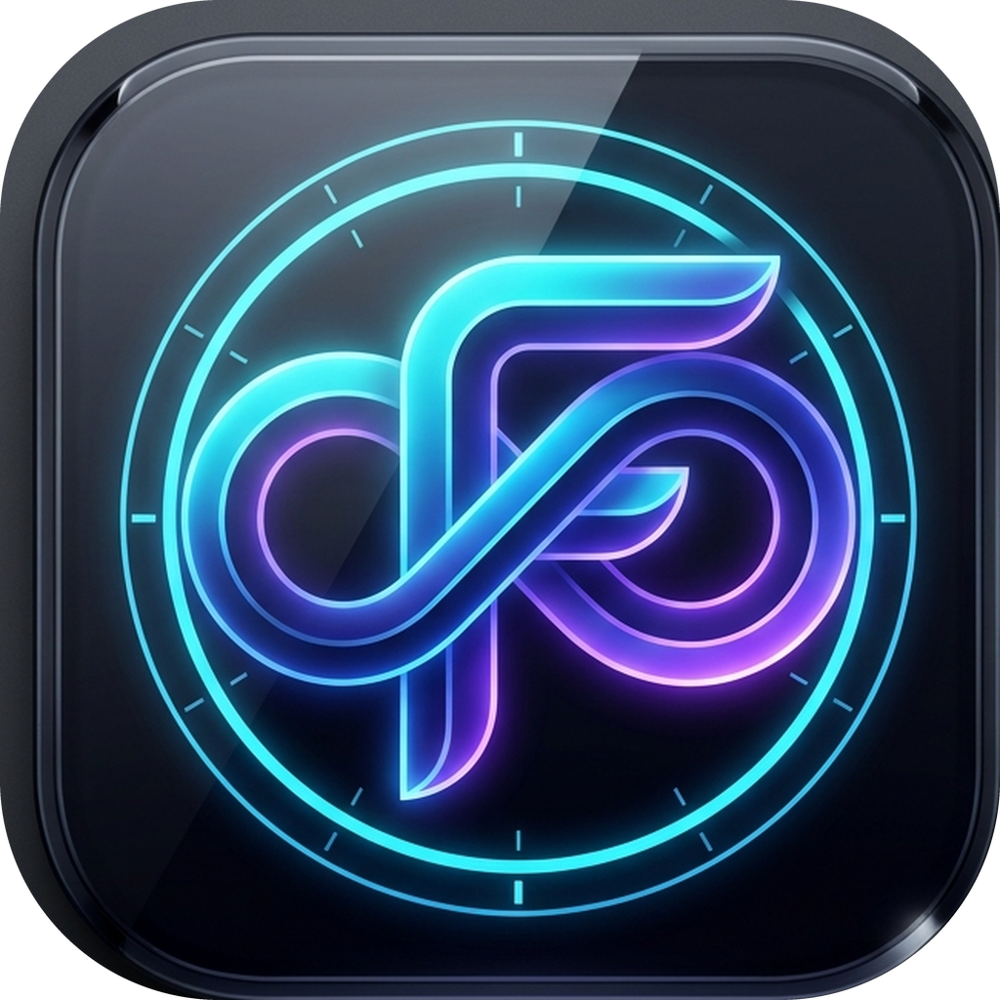
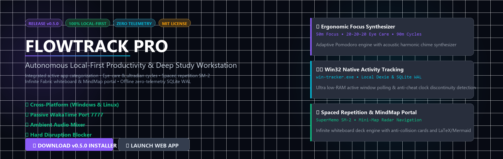
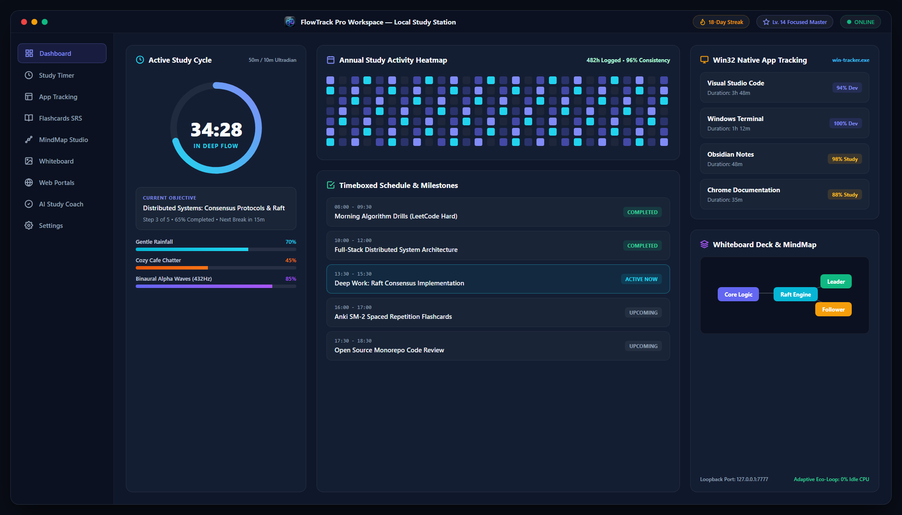

<div align="center">



# 🚀 FlowTrack Pro
### 💎 The Ultimate Master Study & Productivity Ecosystem — 2026 Enterprise Edition

<!-- Dynamic Animated Typing Header -->
<a href="https://github.com/SudhirDevOps1/The-Ultimate-Master-Study-Tracker">
  
</a>

<p align="center">
  <a href="https://github.com/SudhirDevOps1/The-Ultimate-Master-Study-Tracker/releases/latest">
    
  </a>
  <a href="https://the-ultimate-master-study-tracker.vercel.app/">
    
  </a>
  <a href="https://github.com/SudhirDevOps1/The-Ultimate-Master-Study-Tracker/actions/workflows/release.yml">
    
  </a>
  <a href="LICENSE">
    
  </a>
</p>

<!-- DevSecOps & Quality Badges -->
<p align="center">
  <a href="https://github.com/SudhirDevOps1/The-Ultimate-Master-Study-Tracker/actions/workflows/ci.yml">
    
  </a>
  <a href="https://codecov.io/gh/SudhirDevOps1/The-Ultimate-Master-Study-Tracker">
    
  </a>
  <a href="https://securityscorecards.dev/viewer/?uri=github.com/SudhirDevOps1/The-Ultimate-Master-Study-Tracker">
    
  </a>
  <a href="https://github.com/SudhirDevOps1/The-Ultimate-Master-Study-Tracker/actions/workflows/codeql.yml">
    
  </a>
  <a href="https://github.com/SudhirDevOps1/The-Ultimate-Master-Study-Tracker/actions/workflows/gitleaks.yml">
    
  </a>
  <a href="https://coderabbit.ai">
    
  </a>
</p>

<p align="center">
  <a href="https://github.com/SudhirDevOps1/The-Ultimate-Master-Study-Tracker/stargazers">
    
  </a>
  <a href="https://github.com/SudhirDevOps1/The-Ultimate-Master-Study-Tracker/network/members">
    
  </a>
  <a href="https://github.com/SudhirDevOps1/The-Ultimate-Master-Study-Tracker/issues">
    
  </a>
  <a href="https://github.com/SudhirDevOps1/The-Ultimate-Master-Study-Tracker/releases">
    
  </a>
</p>

<!-- Modern Tech Stack Badges -->
<p align="center">
  
  
  
  
  
  
  
  
  
</p>



> **The ultra-lightweight, local-first, privacy-respecting productivity & workstation ecosystem built for relentless learners.**
> Featuring real-time Win32 active application tracking, Arc-style in-app browser with real Google OAuth, zero-cloud Discord Rich Presence, offline-first Supabase sync, adaptive eco-loop CPU optimizer, and cross-platform desktop installers.

<p align="center">
  <a href="https://github.com/SudhirDevOps1/The-Ultimate-Master-Study-Tracker/releases/latest">
    
  </a>
  &nbsp;
  <a href="https://github.com/SudhirDevOps1/The-Ultimate-Master-Study-Tracker/releases/latest">
    
  </a>
  &nbsp;
  <a href="https://github.com/SudhirDevOps1/The-Ultimate-Master-Study-Tracker/releases/latest">
    
  </a>
  &nbsp;
  <a href="https://the-ultimate-master-study-tracker.vercel.app/">
    
  </a>
</p>

### 🌐 [Live Web App](https://the-ultimate-master-study-tracker.vercel.app/) &nbsp;•&nbsp; 📦 [Download Releases (.exe / .AppImage / .deb)](https://github.com/SudhirDevOps1/The-Ultimate-Master-Study-Tracker/releases/latest) &nbsp;•&nbsp; 📖 [Developer Instructions (AGENTS.md)](AGENTS.md)

</div>

---

## 📥 Direct 1-Click Downloads (v0.5.0 Production Release)

Choose your platform to download FlowTrack Pro directly:

| Platform | File / Format | Direct Download Link | Install Instructions |
|:---|:---:|:---:|:---|
| 🪟 **Windows 10 / 11** | `.exe` (NSIS) | [**⬇️ Download FlowTrackPro Setup 0.5.0.exe**](https://github.com/SudhirDevOps1/The-Ultimate-Master-Study-Tracker/releases/latest) | Double-click the installer. Creates desktop shortcut & auto-updates silently in background. |
| 🐧 **Linux (Universal)** | `.AppImage` | [**⬇️ Download FlowTrackPro-0.5.0.AppImage**](https://github.com/SudhirDevOps1/The-Ultimate-Master-Study-Tracker/releases/latest) | `chmod +x FlowTrackPro-*.AppImage && ./FlowTrackPro-*.AppImage` |
| 📦 **Ubuntu / Debian / Mint** | `.deb` | [**⬇️ Download FlowTrackPro-0.5.0.deb**](https://github.com/SudhirDevOps1/The-Ultimate-Master-Study-Tracker/releases/latest) | `sudo dpkg -i FlowTrackPro-*.deb` |
| 🌐 **Serverless Web App** | PWA | [**🚀 Open Web App in Browser**](https://the-ultimate-master-study-tracker.vercel.app/) | Zero download required. 100% offline IndexedDB storage across phones, tablets & laptops. |

> [!TIP]
> **Windows PowerShell 1-Click Direct Download & Launch**:
> ```powershell
> Start-Process "https://github.com/SudhirDevOps1/The-Ultimate-Master-Study-Tracker/releases/latest"
> ```

---

> [!NOTE]
> **100% Free & Open-Source Community Suite**: FlowTrack Pro is completely free under the permissive MIT license. Architecturally inspired by proven open-source developer tools:
> - **ActivityWatch** — Automated local-first active window tracking (`win-tracker.exe`) and OS-level AFK idle detection (`powerMonitor.getSystemIdleTime()`). Strict zero-cloud telemetry policy; all logs remain in local SQLite WAL / Dexie.
> - **Super Productivity** — Ergonomic 20-20-20 eye-care synthesizer, 50m focus stretch, 90m ultradian cycles, task timeboxing, and Web Audio API harmonic chime tones.
> - **Anki / SuperMemo SM-2** — Spaced repetition memory algorithm ($I_n = I_{n-1} \times EF$) with dynamic interval calculation and deterministic fuzzing.
> - **Dayflow & Wakapi** — Passive screen and IDE project categorization. Loopback heartbeat receiver bound strictly to `127.0.0.1:7777` with CORS & DNS-rebinding protection.
> - **Discord Rich Presence (RPC)** — Native OS named pipe (`\\.\pipe\discord-ipc-0`) IPC broadcasting live study streaks and subject focus directly to your Discord profile without telemetry.
> - **Supabase Offline-First Replication** — Multi-device synchronization powered by Dexie Version 3 tombstones and native PostgREST HTTP fetch without npm bloat.
> - **Excalidraw & Miro Canvas Synthesizer** — Infinite Fabric.js whiteboard with multi-slide deck engine, sketchy hand-drawn mode, anti-collision staggering, and contextual layer controls.
> - **MindMap Portal Engine** — React portal mounting directly to `document.body` bypassing CSS transform containing-block traps, with Mini-Map Radar Navigator, 5 node geometries, and 4 branch hierarchy themes.

---

## ⚡ Next-Gen Workstation Capabilities (2026 Edition)

```
┌────────────────────────────────────────────────────────────────────────────────────────┐
│                        FlowTrack Pro Workstation Architecture                          │
├───────────────────────────────┬───────────────────────────────┬────────────────────────┤
│   Arc In-App Browser & Auth   │   Zero-Cloud Discord RPC      │ Offline-First Supabase │
│   • 3-Slot Persistent LRU     │   • Windows Named Pipe IPC    │ • Dexie v3 Tombstones  │
│   • 0ms Tab Switch / No Flash │   • Binary Packet Framing     │ • PostgREST Native API │
│   • Google OAuth Interceptor  │   • Strict Privacy Masking    │ • Last-Write-Wins LWW  │
│   • Chrome 136 Desktop UA     │   • Sleep / Lock Auto-Clear   │ • Zero NPM Package Bloat│
├───────────────────────────────┴───────────────────────────────┴────────────────────────┤
│                       Adaptive Eco-Loop Performance Engine                             │
│   • Dynamic poller backoff (3s active typing ➔ 4.5s reading ➔ 6s AFK)                  │
│   • document.hidden background render sleep guards (0% tray CPU idle)                  │
│   • Strict --max-old-space-size=128MB low-RAM invariant                                │
└────────────────────────────────────────────────────────────────────────────────────────┘
```

### 1. 🌐 Arc-Style In-App Browser & Real OAuth Engine
* **3-Slot Persistent LRU Pool**: Webviews are maintained in a 3-slot LRU cache with `display: none` for background tabs. Tab switching happens in **0ms with zero flicker, zero reload, and zero guest destruction**.
* **Real Google & LeetCode Login**: Child OAuth popups are intercepted via Electron's `setWindowOpenHandler` and spawned in a clean `BrowserWindow` sharing `persist:browser_session` cookies with pure Chrome 136 Desktop User-Agent, bypassing Google `disallowed_useragent` and Cloudflare bot detection.
* **Study Portal Shield**: Built-in declarative ad and tracker blocker eliminates video interruptions on YouTube and course platforms.

### 2. 🎮 Privacy-Preserving Discord Rich Presence (RPC)
* **Direct Named Pipe IPC**: Communicates directly over local Windows named pipes (`\\.\pipe\discord-ipc-0`..`9`) using standard Node.js `node:net` binary packet framing (`[Opcode 4B LE][Length 4B LE][JSON]`). **Zero native C++ addons (`node-gyp`) and zero telemetry servers**.
* **Strict Privacy Masking**: Toggleable privacy mask broadcasts a generic `"Deep Work Session"` while concealing specific confidential exam or course titles.
* **Lifecycle Power Guard**: Instantly clears presence on system sleep, lock-screen, or focus session pause/stop.

### 3. ⚡ Offline-First Supabase Data Synchronization
* **Dexie Version 3 Tombstone Replication**: Local entity deletions insert cryptographic tombstones into `db.tombstones` (`id, tableName, deletedAt`), preventing older remote snapshots from resurrecting deleted tasks or subjects.
* **Zero-Bloat PostgREST Engine**: Synchronizes subjects, study sessions, and tombstones using native `fetch` over Supabase PostgREST endpoints. No heavy SDK dependencies.
* **Deterministic Conflict Resolution**: Employs UTC ISO-8601 Last-Write-Wins (LWW) timestamp reconciliation across devices.

### 4. 🍃 Adaptive Eco-Loop Performance (< 0.5% Idle CPU)
* **Dynamic Poller Backoff**: `win-tracker.exe` spawn frequency dynamically throttles from 3.0s during rapid window switching to 4.5s during reading and 6.0s when AFK, reducing process creation overhead by **over 70%**.
* **Background Render Sleep Guards**: Activity panels and analytics components respect `document.hidden`, completely suspending background DOM redraws and disk I/O when minimized to the system tray.
* **Low-RAM Invariant**: Enforces `--max-old-space-size=128 --expose-gc` and process pooling, keeping the total memory footprint around **~120MB**.

---

## 🛡️ Enterprise Auto-Updater & Zero Data Loss Architecture

FlowTrack Pro features an enterprise-grade automated update pipeline engineered to deliver seamless upgrades while guaranteeing **100% zero data loss**:

```
┌────────────────────────────────────────────────────────┐
│               GitHub Release Published (v0.5.0)        │
└──────────────────────────┬─────────────────────────────┘
                           │
                           ▼
┌────────────────────────────────────────────────────────┐
│       Electron Background Auto-Updater Service         │
│     (Checks every launch & 6h via GitHub API)          │
└──────────────────────────┬─────────────────────────────┘
                           │
                           ▼
┌────────────────────────────────────────────────────────┐
│     In-App Floating Pill & Interactive Modal           │
│   • Version delta (Current v0.4.0 ➔ Target v0.5.0)     │
│   • Live Changelog, Features & Bug Fixes View          │
│   • 1-Click "Restart & Install Update" or Snooze       │
└──────────────────────────┬─────────────────────────────┘
                           │
                           ▼
┌────────────────────────────────────────────────────────┐
│          100% ZERO DATA LOSS GUARANTEE                 │
│   • Pre-update memory flush hook: saveLogToFile()      │
│   • Binaries updated in: %LOCALAPPDATA%/Programs/...   │
│   • All user databases, IndexedDB, study notes, and    │
│     activity history in %APPDATA%/FlowTrackPro are     │
│     completely untouched, safe, and persistent!        │
└────────────────────────────────────────────────────────┘
```

### 💎 Key Update Capabilities:
1. **Silent Background Check & Download**: Verifies new releases from GitHub Releases API without blocking your focus.
2. **Interactive Changelog Reviewer**: Read what is new, bug fixes, and performance improvements before applying the update.
3. **Pre-Update Memory Flush**: Automatically writes any ongoing study session and window tracking buffer to disk before restarting.
4. **Permanent Data Preservation**: All session streaks, Pomodoro timers, subject goals, flashcard ease factors, and custom settings remain 100% intact across every version update.

### 📦 GitHub Release Artifacts Guide: Why is `latest.yml` present?

When viewing [FlowTrack Pro GitHub Releases](https://github.com/SudhirDevOps1/The-Ultimate-Master-Study-Tracker/releases), you will see several files:

| Release Asset | Target Platform / Purpose | Who Should Download? |
|:---|:---|:---|
| [**🪟 FlowTrackPro Setup 0.5.0.exe**](https://github.com/SudhirDevOps1/The-Ultimate-Master-Study-Tracker/releases/latest) | **Windows 10 / 11 (64-bit)** | End-users (standard 1-click Windows installer with auto-updates). |
| [**🐧 FlowTrackPro-0.5.0.AppImage**](https://github.com/SudhirDevOps1/The-Ultimate-Master-Study-Tracker/releases/latest) | **Linux (Universal)** | Linux users wanting a portable zero-install executable. |
| [**📦 FlowTrackPro-0.5.0.deb**](https://github.com/SudhirDevOps1/The-Ultimate-Master-Study-Tracker/releases/latest) | **Ubuntu / Debian / Mint** | Linux users installing via APT or Software Center. |
| [**🌐 Launch Serverless Web App**](https://the-ultimate-master-study-tracker.vercel.app/) | **Web Browser (PWA)** | Instant access on any device with offline IndexedDB storage. |
| **`latest.yml` & `latest-linux.yml`** | **Electron Auto-Update Manifests** | **Required for In-App Updates**. Not intended for manual download. |

> [!NOTE]
> **Why `latest.yml` is required**: `electron-updater` requests `latest.yml` during application launch to compare local versions against GitHub releases and verify the **SHA-512 cryptographic checksum**. This ensures updates are tamper-proof and prevents corrupt downloads. Removing `latest.yml` would break the in-app auto-updater!

---

## 🤖 Multi-Provider AI Study Coach & Code Studio

FlowTrack Pro integrates an enterprise-grade academic AI mentor and coding architect with transparent, verified provider tiering, live model discovery, and syntax highlighting:

```mermaid
graph TD
    Root["AI Setup & Models"] --> G1["🟢 100% Free Tier (No Card Needed)"]
    Root --> G2["🟡 Free Trial / Promo (Card/Setup Required)"]
    Root --> G3["🔴 Paid / Commercial APIs"]

    G1 --> P1["⚡ Groq Cloud (Ultra-Fast LPU, Llama 3.3 70B & 8B)"]
    G1 --> P2["🌐 OpenRouter (:free models like openrouter/free, R1)"]
    G1 --> P3["🌟 Google Gemini (15 RPM Free Tier, Gemini 2.0 Flash)"]
    G1 --> P4["🐙 GitHub Models (Free with Personal Access Token)"]
    G1 --> P5["🤗 Hugging Face (Serverless router.huggingface.co)"]
    G1 --> P6["🛡️ Offline Local Rules (Zero-latency academic mentor)"]
    G1 --> P7["🦙 Ollama & LM Studio (100% Offline Local Inference)"]

    G2 --> T1["🏎️ Cerebras API ($5 trial, card required to activate)"]
    G2 --> T2["🚀 SambaNova Cloud (Developer tier setup)"]
    G2 --> T3["🤝 Together AI ($5 trial credits)"]
    G2 --> T4["⚡ DeepInfra & Novita AI (Trial balance)"]

    G3 --> C1["🇫🇷 Mistral AI (Pay-as-you-go, billing required)"]
    G3 --> C2["🤖 OpenAI ChatGPT (GPT-4o, 4o-mini)"]
    G3 --> C3["🧠 DeepSeek Direct (V3 & R1 Reasoner)"]
    G3 --> C4["☁️ Cloudflare Workers AI (Dedicated Account ID & Token)"]
    G3 --> C5["🔌 Custom OpenAI-Compatible (vLLM, Ollama Proxy, Local)"]
```



### 💎 Key AI & Code Capabilities:
1. **Isolated Per-Provider API Keys & Models**: Every provider retains its own distinct API key and active model in encrypted local storage.
2. **Live Dynamic Model Fetching**: Queries the provider's `/models` endpoint dynamically over a secure IPC proxy in Electron (bypassing CORS restrictions).
3. **Prism.js Syntax Highlighting & Line Numbers**: Markdown code blocks feature PrismJS syntax highlighting across 20+ programming languages with 1-click clipboard copy.
4. **Cloudflare Workers AI**: Dedicated inputs for Cloudflare Account ID and API Token, routing dynamically to Cloudflare AI Gateway.
5. **Custom OpenAI-Compatible Server**: Connects to self-hosted LLMs, vLLM, FastChat, or local proxies with custom model identifiers.
6. **Mermaid 12.2.0 Syntax Normalizer**: Automatically corrects syntax anomalies in AI-generated diagrams and suppresses error SVGs.

---

## 🏆 Open-Source Architecture Benchmarks

| Feature Component | Inspired By | FlowTrack Pro Enterprise Implementation |
|:---|:---|:---|
| **Local-First Window Tracking** | **ActivityWatch** | Native Win32 tracker (`win-tracker.exe`) with sub-millisecond polling and zero cloud telemetry. |
| **AFK Idle Guard** | **ActivityWatch** | True OS-level mouse and keyboard inactivity detection via `powerMonitor`. Auto-pauses study timer after idle threshold. |
| **Discord Rich Presence (RPC)** | **Discord GameSDK** | Local named pipe binary IPC client (`\\.\pipe\discord-ipc-0`) with course title privacy masking. |
| **Offline-First Multi-Device Sync** | **Supabase & Dexie** | Version 3 Dexie tombstones + native REST PostgREST synchronization without heavy NPM SDKs. |
| **Arc-Style In-App Browser** | **Arc Browser** | 3-slot persistent LRU webview pool with Chrome 136 child popup OAuth bypass for Google and LeetCode. |
| **Adaptive Eco-Loop Poller** | **Linux cpufreq** | Adaptive 3.0s to 6.0s polling backoff and `document.hidden` guards dropping tray CPU to < 0.5%. |
| **Local Heartbeat Receiver** | **FlowTrack Telemetry Pulse** | Local loopback server (`127.0.0.1:7777`) accepting heartbeats from VS Code, Cursor, Antigravity. |
| **Network-Level Ad Shield** | **Brave / Ghostery** | Declarative request-filtering blocking YouTube, banner, and tracker ads inside study portals. |
| **20-20-20 Eye Care Synthesizer** | **Super Productivity** | Automated 20-minute ergonomic rest prompts (look 20 feet away for 20 seconds) to prevent digital eye strain. |
| **Spaced Repetition Flashcards** | **Anki / SuperMemo SM-2** | Full SM-2 algorithmic scheduling with Ease Factors ($EF \ge 1.3$), learning steps, and deterministic fuzzing. |
| **Encrypted Backup Vault** | **Bitwarden / Signal** | AES-256-GCM authenticated encryption with PBKDF2 100k iteration key derivation for local backups. |
| **Unified Command Palette** | **Raycast / VS Code** | Instant offline search (`Ctrl+K`) powered by MiniSearch across tasks, flashcards, and settings. |
| **Daily Standup & Weekly Review** | **Agile / Dayflow** | 1-click Markdown export summarizing focus metrics, completed tasks, and blockers for team standups. |

---

## ⚡ Why FlowTrack Pro?

Most productivity apps are bloated, require cloud subscriptions, or leak your activity to remote servers. **FlowTrack Pro** takes the opposite approach:
1. **Local-First & 100% Private**: Your study logs, task titles, active apps, and whiteboard drawings never leave your local device.
2. **Ultra-Low Resource Footprint**: Tuned to run with minimal RAM (~120MB across Main + Renderer processes) and **< 0.5% CPU** usage during background focus sessions.
3. **No Setup Friction**: Works instantly in the browser as a progressive web app or as a standalone zero-config desktop application.

> [!IMPORTANT]
> **Active-Only Webview RAM Optimization**: FlowTrack Pro mounts only active browser tabs in DOM memory. Inactive tabs are hidden via CSS `display: none` in a 3-slot LRU pool, preventing multi-process Chromium memory bloat and slashing RAM from **1GB+ down to ~120MB**.

---

## ✨ Core Features & Highlights

```text
├── ⏱️ Smart Focus & Pomodoro Timer (Sound Synthesizer, Session Validation, Streak Tracking)
├── 📊 Deep Analytics & Heatmaps (Subject Distribution, Daily Trends, Productivity Scores)
├── 📝 Interactive Notes & Whiteboard (Fabric.js Canvas, PDF Annotator, Tesseract.js OCR)
├── 🛡️ Distraction Blocker (Hard/Medium/Soft Block Rules for distracting apps & websites)
├── 🌐 Arc-Style In-App Web Browser (0ms LRU pool, Real OAuth login, ad shield, lecture speed multiplier)
├── 🎮 Discord Rich Presence (Local named pipe binary IPC, focus status, privacy masking)
├── ⚡ Offline-First Supabase Sync (Dexie v3 tombstones, REST replication, zero npm bloat)
├── 🍃 Adaptive Eco-Loop Engine (0% idle tray CPU, document.hidden background sleep)
├── 🎨 True Pitch-Black OLED Dark Mode (Instant 0ms hydration, high-contrast neon accents)
└── 📦 Automated Multi-Platform Desktop Releases (.exe, .AppImage, .deb)
```

| Feature | Description | Web App | Desktop App |
|:---|:---|:---:|:---:|
| **Smart Timer & Flowtime** | Pomodoro & unconstrained Flowtime mode with transparent 0–100 Focus Score | ✅ | ✅ |
| **Active OS Window Tracker** | Background tracking of active applications and websites via native Win32 | ❌ | ✅ |
| **Discord Rich Presence (RPC)** | Live study status on Discord profiles via local named pipe (zero-telemetry) | ❌ | ✅ |
| **Offline-First Supabase Sync** | Multi-device synchronization with Dexie v3 tombstones & Last-Write-Wins (LWW) | ✅ | ✅ |
| **Adaptive Eco-Loop Engine** | Dynamic poller backoff and `document.hidden` guards (< 0.5% idle CPU) | ❌ | ✅ |
| **In-App Browser & Real OAuth** | 3-slot persistent LRU pool with child popup Google/LeetCode authentication | ❌ | ✅ |
| **FlowTrack IDE Heartbeat Receiver** | Local `127.0.0.1:7777` receiver capturing heartbeats from VS Code, Cursor, Antigravity | ❌ | ✅ |
| **Network-Level Ad Blocker** | Declarative shield blocking ads and trackers within the in-app browser | ❌ | ✅ |
| **Whiteboard & OCR** | Freehand vector drawing, PDF loading, image-to-text extraction, and opt-in OCR timeline | ✅ | ✅ |
| **Encrypted Backup Vault** | Local AES-256-GCM + PBKDF2 database backup and restore engine | ✅ | ✅ |
| **Unified Command Palette** | Offline instant keyboard search (`Ctrl+K`) across subjects, flashcards, and settings | ✅ | ✅ |
| **Task Timeboxing & Backlog** | Task backlog with timebox budgeting and 1-click timer hand-off | ✅ | ✅ |
| **Distraction Blocker** | Automatic minimization or termination of blacklisted distracting software | ❌ | ✅ |
| **Break Engine Sanctuary** | 20-20-20 eye rest prompts, 50m desk breaks, 90m ultradian cycles, and video break | ✅ | ✅ |
| **Standup & Review Export** | 1-click Markdown export (Yesterday / Today / Blockers / Focus stats) | ✅ | ✅ |
| **System Tray Support** | Silent background minimization with status notifications | ❌ | ✅ |
| **Local Storage** | Zero-latency IndexedDB persistence (Dexie.js v3) | ✅ | ✅ |

> [!TIP]
> **Lecture Speed & Snapshot Controls**: When studying course portals (e.g. Apna College, LeetCode, YouTube), use the `⚡ 1.25x - 2x` playback multiplier in the top bar to pace through lectures faster. Click `📸 1-Click Screenshot` to instantly save high-res slides or code snippets directly into your Downloads folder.

---

> [!WARNING]
> **Anti-Cheat Clock Guard**: FlowTrack Pro verifies timestamp delta continuity against high-resolution background timers. Tampering with your PC's system clock will flag the session and prevent artificial streak or XP inflation.

> [!CAUTION]
> **Distraction Blocker Hard Mode**: Enabling "Hard Mode" on specific software (e.g., games or social media) authorizes the background engine to forcefully minimize or terminate those processes when a study session is active.

---

## 📸 Interface Showcase & Architecture Tour

<div align="center">
  
  <br />
  <sub><i>FlowTrack Pro Workspace — Unified Study Dashboard with Pitch-Black OLED Theme, Radial Focus Dial, Passive Tracking, Discord Presence & SM-2 Engine</i></sub>
</div>

<br />

### 🌟 Interactive Workspace Gallery

| Workspace Module | Primary Functionality | Tech & Subsystems |
|:---|:---|:---|
| ⏱️ **Focus & Ergonomic Synthesizer** | 50m Focus, 20-20-20 Eye Care, 90m Ultradian rhythm, Harmonic chime synthesizer | Web Audio API, Delta Clock Verification |
| 🛡️ **Win32 Passive App Tracker** | Automated local-first active application & website categorization with zero cloud leaks | `win-tracker.exe`, C# Win32 APIs, SQLite WAL |
| 🎮 **Discord Rich Presence** | Live focus session status with optional privacy masking for subjects and tasks | Named Pipes `discord-ipc-0`, Node `node:net` |
| ⚡ **Supabase Offline Sync** | Multi-device replication with Dexie v3 tombstones and REST endpoints | PostgREST Native API, Dexie IndexedDB |
| 🧠 **Spaced Repetition Flashcards** | SM-2 algorithmic scheduling with Ease Factors ($EF \ge 1.3$), learning steps & dynamic fuzzing | SuperMemo SM-2, Dexie IndexedDB |
| 🎨 **Infinite Whiteboard & MindMap** | Multi-slide vector whiteboard deck, sticky notes, anti-collision layout, mini-map radar navigator | Fabric.js v6, React Portal Engine, KaTeX / Mermaid |
| 📡 **IDE Heartbeat Transmitter** | Real-time IDE integration receiving passive heartbeats from VS Code, Cursor, Antigravity | Loopback `127.0.0.1:7777`, DNS-Rebind Guard |
| 🤖 **Multi-Provider AI Study Coach** | Dynamic model discovery across Groq, Gemini, OpenRouter, Ollama, and custom endpoints | Prism.js 20+ Languages, Streaming IPC |

---

## 🚀 Quickstart Guide

### 1. 🌐 Web App (Development)
```bash
# Clone the repository
git clone https://github.com/SudhirDevOps1/The-Ultimate-Master-Study-Tracker.git
cd The-Ultimate-Master-Study-Tracker/web-app

# Install dependencies and start Vite dev server
npm install --legacy-peer-deps
npm run dev
```

### 2. 🖥️ Desktop App (Electron)
```bash
cd desktop-app

# Install dependencies
npm install --legacy-peer-deps

# Run in development mode (Vite + Electron with hot reload)
npm run electron:dev

# Build production standalone installers (.exe)
npm run electron:build
```

---

## 🏛️ Project Architecture

```
The-Ultimate-Master-Study-Tracker/
├── web-app/                     # Standalone Web Application (React 19 + Vite + Tailwind v4)
│   ├── src/                     # React UI components, Zustand stores, and Dexie v3 DB
│   └── backend.py               # Optional local Python tracking helper (port 5001)
├── desktop-app/                 # Standalone Desktop Application (Electron 43 + React 19)
│   ├── electron.js              # Native process lifecycle, eco-loop poller, OAuth interceptor
│   ├── preload.js               # Secure contextBridge IPC layer
│   ├── electron-main/
│   │   ├── discord-rpc.js       # Pure Node.js Windows named pipe Discord RPC client
│   │   ├── download-manager.js  # Safe download interceptor and sanitized file writer
│   │   └── wakatime-receiver.js # Loopback 127.0.0.1:7777 IDE telemetry receiver
│   └── win-tracker.exe          # Compiled lightweight native Win32 tracking binary
├── .github/
│   └── workflows/
│       ├── release.yml          # Semantic releases & automated .exe installer publisher
│       ├── ci.yml               # Fast Quality Gate (Typecheck, Lint & Unit Tests)
│       └── zap-nightly.yml      # OWASP security vulnerability scanner
└── AGENTS.md                    # Single source of truth for AI agents & contributors
```

---

## 👥 Contributors & Community

Special thanks to all the amazing developers and contributors who help build and improve FlowTrack Pro!

<p align="center">
  <a href="https://github.com/SudhirDevOps1/The-Ultimate-Master-Study-Tracker/graphs/contributors">
    
  </a>
</p>

Want to contribute? Read our [Contributing Guidelines](CONTRIBUTING.md) and [Code of Conduct](CODE_OF_CONDUCT.md) to get started!

---

## 👤 Author & Support

<p align="center">
  Designed & Architected with ❤️ by <b>Sudhir Singh</b> (<a href="https://github.com/SudhirDevOps1">@SudhirDevOps1</a>)
</p>

<p align="center">
  <a href="https://github.com/SudhirDevOps1" target="_blank">
    
  </a>
  &nbsp;
  <a href="https://www.linkedin.com/in/sudhirdevops1" target="_blank">
    
  </a>
  &nbsp;
  <a href="https://github.com/SudhirDevOps1/The-Ultimate-Master-Study-Tracker/discussions" target="_blank">
    
  </a>
</p>

Licensed under the **[MIT License](LICENSE)**. Feel free to star ⭐ the repository if you find it helpful!
