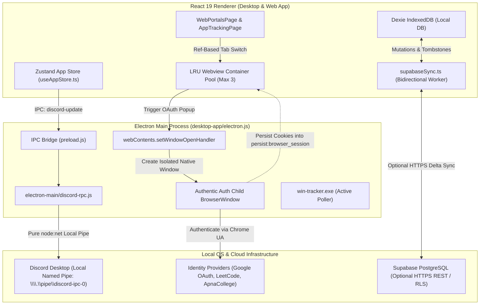

# Technical Design Document: FlowTrack Pro Next-Gen Workstation Capabilities

**Status:** Approved & Finalized (Ready for Execution)  
**Authors:** FlowTrack Pro Core Engineering  
**Target Release:** v0.6.0  
**Predecessor Document:** `concepts_brief.md`  

---

## 1. Context & The Problem

FlowTrack Pro is an ultra-lightweight, local-first productivity and deep study workstation built for developers, students, and self-directed learners. As study sessions increasingly span web documentation, course platforms, community discord channels, and multi-device study setups, users encounter three severe operational roadblocks:

1. **In-App Chromium Browser Instability & OAuth Breakage**:
   - The embedded in-app browser (`WebPortalsPage.tsx`) experiences severe screen flickering, blank-screen flashes, and uncommanded page reloads during navigation. This occurs because URL and title state updates (`setTabs`) trigger top-level React re-render cascades that unmount and recreate the underlying `<webview>` DOM node (`key={activeTab.id}`).
   - Embedded authentication is fundamentally broken on essential learning platforms (Google OAuth, LeetCode, Apna College, Coursera). Google and modern identity providers identify the embedded `<webview>` context and block login attempts with `403 disallowed_useragent` or "This browser or app may not be secure" security exceptions.
2. **Absence of Peer Accountability via Discord Rich Presence (RPC)**:
   - Modern learners spend long hours in developer study circles and Discord learning guilds. Currently, FlowTrack Pro has no presence integration to broadcast active focus timers, current study topics, or daily streaks. 
   - Existing open-source tools either use heavy remote Discord bots or leak cloud telemetry. FlowTrack Pro requires a strictly local-first, privacy-preserving RPC mechanism.
3. **Data Siloing Across Multi-Device Environments**:
   - Learners who switch between a primary desktop workstation (Electron) and secondary laptop/mobile browsers (Web App) have their study logs, session streaks, and spaced repetition flashcards siloed on individual devices.
   - FlowTrack Pro's non-negotiable architectural invariant is **100% Local-First & Zero-Cloud Telemetry**. Any cloud synchronization must remain purely opt-in without degrading offline functionality, compromising local SQLite WAL/Dexie guarantees, or resetting SuperMemo SM-2 spaced repetition curves.

---

## 2. Overview

This design establishes a hardened three-pillar workstation upgrade:
- **Pillar 1 (Decoupled Browser & Authentic Auth)**: Decouple `<webview>` instance lifecycles from React state re-render loops using a persistent Least-Recently-Used (LRU) DOM container pool (capped at 3 instances to satisfy the 128MB old-space RAM constraint). Route OAuth popups via Electron `webContents.setWindowOpenHandler` to an isolated child `BrowserWindow` with full Chrome 136 desktop emulation and shared session partitioning (`persist:browser_session`), closing on redirect and persisting cookies seamlessly.
- **Pillar 2 (Privacy-Preserving Discord RPC)**: A modular local IPC daemon in `desktop-app/electron-main/discord-rpc.js` communicating directly with local Discord desktop client named pipes (`\\.\pipe\discord-ipc-0` via pure `node:net`). 100% opt-in in Settings, rate-limited to 15s intervals, with OS-level AFK auto-clear hooks.
- **Pillar 3 (Offline-First Supabase Data Sync)**: A bidirectional synchronization engine (`desktop-app/src/lib/supabaseSync.ts` and byte-mirrored `web-app/src/lib/supabaseSync.ts`) layered on top of Dexie IndexedDB. Employs a local `tombstones` table for deletions, monotonic Last-Write-Wins (LWW) conflict resolution for sessions and tasks, and deterministic SM-2 reconciliation for flashcard repetition schedules.

---

## 3. Goals

- **Zero-Flicker Web Navigation**: Tab switching among active portals must occur with 0ms blanking or page re-renders.
- **100% Successful Authentication**: Enable seamless Google OAuth, LeetCode, and course portal logins with shared session cookies and zero `disallowed_useragent` blocks.
- **Strict Low-RAM Compliance**: Embedded webview instances must not exceed a 3-instance LRU pool, preserving the `--max-old-space-size=128` low-memory budget.
- **Privacy-Preserving Discord RPC**: Broadcast focus subject, elapsed Pomodoro timer, and streak with zero cloud telemetry, default-off opt-in configuration, and 0% CPU footprint when Discord is not running.
- **Reliable Offline-First Synchronization**: App remains 100% functional without an internet connection or Supabase credentials. When connected, sync recovers cleanly from network drops without duplicate sessions or lost flashcard history.
- **Zero Removal Principle**: Preserve all existing YouTube ad-skip scripts, distraction blocker rules, distraction-free study reader, and credential vault intact.

---

## 4. Non-Goals

- Providing a general-purpose Chrome Web Store extension manager within embedded `<webview>`.
- Mandatory cloud account creation (offline use remains first-class and default).
- Real-time peer-to-peer WebRTC collaborative whiteboard canvas synchronization (handled as a separate roadmap item).
- Discord text messaging or voice channel integration from within FlowTrack Pro.

---

## 5. Technical Plan

### 5.1 System Architecture Diagram



---

### 5.2 Architectural Specifications

#### A. In-App Browser LRU Pool & Child Window OAuth Engine
1. **Root Cause Resolution**:
   - `WebPortalsPage.tsx` will no longer render `<WebviewViewport>` dynamically keyed to `activeTab.id`.
   - Instead, a persistent multi-slot container (`activeTabIds: string[]`) retains up to 3 active tab instances in the DOM.
   - Non-active tabs in the pool receive CSS styling `display: none` rather than unmounting. When switching back, the renderer DOM is already in memory with 0ms delay, zero script re-execution, and zero visual flashing.
   - When a 4th tab is opened, the least-recently-accessed tab is unmounted, strictly bounding Chromium renderer process memory to under 150MB.
2. **Authentic Google / LeetCode Authentication Flow**:
   - In `electron.js`, `setWindowOpenHandler` is updated to inspect requested URLs and disposition.
   - When an authentication domain is detected (`accounts.google.com`, `appleid.apple.com`, `login.microsoftonline.com`, `leetcode.com/accounts`, etc.):
     ```javascript
     contents.setWindowOpenHandler(({ url }) => {
       if (isAuthDomain(url)) {
         return {
           action: "allow",
           overrideBrowserWindowOptions: {
             width: 520,
             height: 680,
             parent: mainWindow,
             modal: false,
             autoHideMenuBar: true,
             webPreferences: {
               partition: "persist:browser_session",
               nodeIntegration: false,
               contextIsolation: true,
               sandbox: true
             }
           }
         };
       }
       shell.openExternal(url);
       return { action: "deny" };
     });
     ```
   - In the child window, Electron injects pure Chrome desktop User-Agent headers, preventing Google's `disallowed_useragent` block.
   - Because the child window shares `persist:browser_session`, authentication cookies and session tokens immediately persist to the parent `<webview>` session partition upon successful OAuth completion.

#### B. Privacy-Preserving Discord Rich Presence (RPC)
1. **Local IPC Socket Implementation (`electron-main/discord-rpc.js`)**:
   - Communicates directly with the local Discord client over OS IPC pipes (`\\.\pipe\discord-ipc-0` on Windows, `/run/user/{uid}/discord-ipc-0` on Linux, `$TMPDIR/discord-ipc-0` on macOS) using Node.js built-in `node:net`.
   - Bypasses heavy C++ native addons (`discord-rpc` / `node-gyp`), ensuring seamless cross-platform compilation on Windows and Linux CI runners without external build toolchains.
2. **State & Throttling Protocol**:
   - Implements a handshake opcode (`OP_HANDSHAKE = 0`) followed by framed JSON frame transmissions (`OP_FRAME = 1`).
   - Dispatches presence payloads:
     ```json
     {
       "cmd": "SET_ACTIVITY",
       "args": {
         "pid": process.pid,
         "activity": {
           "state": "Studying: Advanced Algorithms",
           "details": "Pomodoro Focus (Round 2/4)",
           "timestamps": { "start": 1730800000 },
           "assets": {
             "large_image": "flowtrack_logo",
             "large_text": "FlowTrack Pro v0.6.0",
             "small_image": "streak_flame",
             "small_text": "18-Day Study Streak"
           }
         }
       },
       "nonce": "uuid-v4"
     }
     ```
   - Throttled with a 15-second minimum interval timer to respect Discord client socket limits.
   - Clears status automatically when user goes AFK (`powerMonitor.getSystemIdleTime() > 120s`) or pauses the study timer.

#### C. Offline-First Supabase Data Synchronization
1. **Data Model & Schema Alignment**:
   - Supabase tables mirror existing local Dexie stores with PostgreSQL schemas:
     - `profiles`: `{ id: uuid (auth.uid), display_name, streak_count, total_study_minutes, updated_at }`
     - `subjects`: `{ id: text, user_id: uuid, name, color, goal_hours, is_archived, updated_at }`
     - `study_sessions`: `{ id: text, user_id: uuid, subject_id, start_time, end_time, duration_seconds, focus_score, updated_at }`
     - `tasks`: `{ id: text, user_id: uuid, subject_id, title, is_completed, estimated_minutes, updated_at }`
     - `flashcards`: `{ id: text, user_id: uuid, subject_id, front, back, ease_factor, interval, repetitions, next_review_date, updated_at }`
     - `tombstones`: `{ id: text, user_id: uuid, table_name, deleted_at }`
2. **Tombstone Architecture & Conflict Resolution**:
   - Whenever an item is deleted locally, an entry is inserted into local `tombstones`. During sync, deletions are propagated to Supabase, and remote tombstones purge local stale entities.
   - Conflicts on `subjects`, `study_sessions`, and `tasks` are resolved using Last-Write-Wins (LWW) based on UTC ISO-8601 `updated_at`.
   - Flashcards utilize deterministic SM-2 spaced repetition reconciliation: whichever record has higher `repetitions` or newer `next_review_date` prevails, ensuring learning progress is never rolled back by an older sync snapshot.
3. **Synchronization Lifecycle**:
   - Operates in background worker queue.
   - Triggered on: (1) Application startup, (2) Focus session completion, (3) Network `online` event, (4) Debounced 5-minute interval during active use.

---

## 6. Alternatives Considered

| Feature / Domain | Alternative Evaluated | Why It Was Rejected | Chosen Approach |
|:---|:---|:---|:---|
| **In-App Browser Authentication** | **External System Browser with Custom Deep Links (`flowtrack://auth`)** | Disrupts focus by ejecting learner from the app into Chrome/Edge. Requires OS registry protocol registration and fails to securely inject session cookies back into the isolated `<webview>` partition for subsequent lecture watching. | Native Child `BrowserWindow` sharing `persist:browser_session` partition with pure Chrome desktop user-agent. |
| **In-App Browser Authentication** | **Puppeteer / Playwright Automation** | Bloats installer size by >150MB, consumes 400MB+ RAM (violating the 128MB low-memory limit), and triggers Cloudflare / Google bot-detection CAPTCHAs. | Lightweight native Electron window management via `setWindowOpenHandler`. |
| **Discord Rich Presence** | **C++ Native Addon (`discord-rpc` via `node-gyp`)** | Requires Python and Visual Studio C++ toolchains on developer/user machines, causes binary incompatibility across Electron ABI updates, and frequently breaks Linux CI workflows. | Zero-dependency pure `node:net` socket implementation communicating directly over local named pipes. |
| **Discord Rich Presence** | **Remote Discord Bot via Cloud WebSocket / Gateway** | Violates the core Zero-Cloud / Zero-Telemetry privacy policy. Requires hosting external bot infrastructure, leaks user IPs, and introduces recurring operational costs. | 100% Local IPC socket communicating only on `localhost` with the installed Discord client. |
| **Cloud Synchronization** | **Replacing Dexie with CouchDB / PouchDB** | Requires a total rewrite of existing database layers, breaking backwards compatibility for current users' local IndexedDB data and introducing large sync library overhead. | Layered delta sync on top of existing Dexie schema with local `tombstones` and monotonic `updated_at` timestamps. |
| **Cloud Synchronization** | **Git / GitHub Gist Auto-Commit Sync** | High latency (several seconds per commit), strict GitHub API rate limits (5,000 req/hr), and unable to handle rapid flashcard reviews or real-time streak updates. | Supabase PostgreSQL with Row-Level Security (RLS) over lightweight REST endpoints with offline queueing. |

---

## 7. Detailed Implementation Plan

The implementation is executed as a series of atomic, test-verified changes across the monorepo:

### 7.1 Single Implementation Task Sequence

1. **Phase 1: In-App Browser Decoupling & OAuth Engine**
   - Refactor `desktop-app/src/pages/WebPortalsPage.tsx`:
     - Implement `LRUWebviewPool` state storing up to 3 persistent `<WebviewViewport>` entries.
     - Isolate `handleNavigate` and `handleTitleUpdate` so they update ref-backed state without destroying the `<webview>` element.
     - Assign `display: none` / `display: block` to inactive vs active `<webview>` DOM containers.
   - Update `desktop-app/electron.js`:
     - Harden `contents.setWindowOpenHandler` with comprehensive OAuth matching regex.
     - Direct popups to a child `BrowserWindow` sharing `persist:browser_session` and standard Chrome desktop UA.
     - Add auto-close detector when OAuth finishes redirecting to the host service.

2. **Phase 2: Pure `node:net` Discord Rich Presence Daemon**
   - Create `desktop-app/electron-main/discord-rpc.js`:
     - Implement `DiscordRpcClient` class using `node:net` connect to `\\.\pipe\discord-ipc-0` (Windows) and unix sockets (Linux/macOS).
     - Implement IPC handlers: `discord-rpc-set-activity` and `discord-rpc-clear`.
     - Wire `powerMonitor` AFK idle detection (>120s) to blank presence automatically.
   - Update `desktop-app/preload.js`:
     - Expose `electron.discord` API safely via `contextBridge`.
   - Update `desktop-app/src/store/useAppStore.ts`:
     - Trigger `discord-rpc-set-activity` whenever the Pomodoro timer starts or changes state.

3. **Phase 3: Offline-First Supabase Data Synchronization**
   - Update database schemas in `desktop-app/src/db/database.ts` and `web-app/src/db/database.ts`:
     - Add `tombstones` store: `'id, table_name, deleted_at'`.
     - Add `updated_at` indexes to existing tables.
   - Create `desktop-app/src/lib/supabaseSync.ts` and mirror to `web-app/src/lib/supabaseSync.ts`:
     - Initialize Supabase client lazily when credentials are provided.
     - Implement delta computation, tombstone deletions, and SM-2 flashcard reconciliation.
   - Update `desktop-app/src/pages/SettingsPage.tsx` and `web-app/src/pages/SettingsPage.tsx`:
     - Add Discord RPC configuration card (Toggle: Enabled, Input: Discord App ID, Toggle: Mask Subject Names).
     - Add Supabase Sync card (Inputs: Project URL, Anon Key, Button: Test Connection / Sync Now, Status Indicator: Last Synced).

4. **Phase 4: Unit Testing & CI Verification**
   - Add `desktop-app/src/utils/__tests__/discordRpc.test.ts` to test packet framing, opcode handshakes, and 15s throttling.
   - Add `desktop-app/src/utils/__tests__/supabaseSync.test.ts` to verify LWW conflict resolution, tombstone purging, and SM-2 flashcard merging.
   - Execute full test suite (`npm run typecheck`, `npm run lint`, `npm run test`).

---

### 7.2 Exhaustive File Inventory & Modification Rationale

| File Path | Type | Modification Rationale |
|:---|:---:|:---|
| `desktop-app/src/pages/WebPortalsPage.tsx` | Modified | Replace single-element keyed webview with an LRU pool of 3 persistent instances (`display: none` for inactive); eliminate re-mount flicker on title/url updates. |
| `desktop-app/electron.js` | Modified | Update `setWindowOpenHandler` for child BrowserWindow OAuth with `persist:browser_session`; register Discord RPC IPC listeners and `powerMonitor` idle presence hook. |
| `desktop-app/electron-main/discord-rpc.js` | Created | Zero-dependency Discord Rich Presence client over OS local named pipes (`\\.\pipe\discord-ipc-0`) using pure `node:net`. |
| `desktop-app/preload.js` | Modified | Expose `electron.discord` methods (`setActivity`, `clearActivity`) over secure `contextBridge`. |
| `desktop-app/src/lib/supabaseSync.ts` | Created | Offline-first bidirectional sync worker: delta computation, tombstone propagation, and deterministic SM-2 flashcard conflict resolution. |
| `web-app/src/lib/supabaseSync.ts` | Created | **Duplication Trap Invariant**: Exact byte-identical synchronization worker for the browser application. |
| `desktop-app/src/db/database.ts` | Modified | Add `tombstones` store and `updated_at` indexes to Dexie database schema. |
| `web-app/src/db/database.ts` | Modified | Mirror `tombstones` schema updates to browser Dexie database to maintain parity. |
| `desktop-app/src/pages/SettingsPage.tsx` | Modified | Render Discord RPC settings and Supabase Cloud Sync credential inputs and manual sync triggers. |
| `web-app/src/pages/SettingsPage.tsx` | Modified | Render Supabase Cloud Sync settings and desktop-only badge for Discord RPC. |
| `desktop-app/src/store/useAppStore.ts` | Modified | Trigger Discord status updates and sync queues upon focus session start/stop and task completions. |
| `desktop-app/src/utils/__tests__/discordRpc.test.ts` | Created | Unit test coverage for Discord RPC handshake framing, 15s rate limiter, and error backoff. |
| `desktop-app/src/utils/__tests__/supabaseSync.test.ts` | Created | Unit test coverage for tombstone deletion sync, LWW timestamp merge, and SM-2 interval preservation. |
| `README.md` | Modified | Document new Discord RPC and Supabase Sync capabilities with zero-telemetry and low-RAM guarantees. |
