# 🌐 FlowTrack Pro — Serverless Web Application (Browser & Local Hybrid Edition)

> **Version**: `v0.3.0` | **Platform**: Any Modern Web Browser (Desktop / Mobile / Tablet) | **Deployment**: Vercel CDN

Welcome to the **Web Application** module of FlowTrack Pro. This app operates 100% locally in your browser using IndexedDB for offline data persistence, Progressive Web App (PWA) installation, zero signup requirements, and optional smart auto-connection to the local Python tracker backend.

---

> [!NOTE]
> **Open-Source Architectural Heritage**: Designed with insights from open-source heavyweights:
> - **ActivityWatch** — Low-overhead active window tracking and OS-level AFK idle detection with zero remote server logging.
> - **Super Productivity** — Ergonomic 20-20-20 eye-care synthesizer, task timeboxing, and developer focus techniques.
> - **Anki / SuperMemo SM-2** — Spaced repetition algorithm ($I_n = I_{n-1} \times EF$) with dynamic interval calculation.
> - **Dayflow & Wakapi** — Passive screen and IDE project categorization between deep study, coding, and web research.

---

## 📌 Web App Features

- ⚡ **Vercel CDN Ready**: Instantly deployed on Vercel or any static web host.
- 💾 **100% In-Browser IndexedDB (Zero Data Loss)**: Sessions, flashcards, mind maps, PDF reader state, and settings stay completely persistent in browser storage. App updates and cache refreshes never wipe your study history.
- ⌨️ **Unified Command Palette (`Ctrl+K`)**: Instant offline keyboard search across tasks, flashcards, subjects, and settings using MiniSearch.
- 🔐 **Encrypted Database Backup & Privacy Vault**: Export and restore AES-256-GCM encrypted snapshots with PBKDF2 100k iteration derivation.
- ⏱️ **Flowtime Mode & Transparent Focus Score**: Unconstrained flowtime focus sessions with an auditable, honest 0–100 focus score breakdown.
- 📋 **Task Backlog & Timeboxing**: Timebox allocation for daily tasks and 1-click timer hand-off.
- ☕ **Break Engine & Video Sanctuary**: 20-20-20 eye strain, 50m desk, and 90m ultradian rest alerts + optional video rest modal.
- 📝 **1-Click Standup & Review Markdown**: Instant summary export (Yesterday / Today / Blockers / Focus stats) for agile developers.
- 📱 **Progressive Web App (PWA)**: Install directly to desktop or mobile home screen for offline travel/study mode.
- 🔄 **Smart Local Python Backend Integration**:
  - Automatically connects to `http://localhost:5001` when running `START.bat` on your local PC.
  - Pulls OS active window titles, process screen-time analytics, and browser tab tracking into the web app.
  - Mirrors WakaTime IDE heartbeats in SQLite database (`app_tracker.db`).
  - Automatically falls back to offline IndexedDB mode when local backend is not running.
- 🤖 **Multi-Provider AI Assistant**: Direct browser calls to Gemini, OpenAI, Groq, or local Ollama (via local backend CORS proxy).
- 🎨 **Excalidraw Multi-Slide Whiteboard**: Multi-slide deck engine, auto-cleaning placeholder text, sticky notes, and floating layer toolbar.
- 🧠 **MindMap Studio**: Portal fullscreen mode, interactive Radar navigator, 5 node shapes, and 4 branch hierarchy palettes.
- ⚡ **Real-Time Developer Studio**: Telemetry pulse stream with instant search, 1-click IDE config, and heartbeat clearing.

---

## 🚀 One-Click Local Launcher (`START.bat`)

To run the Web App locally along with the Python Tracker Backend:

1. Double-click `START.bat` (or run `.\START.bat` in terminal).
2. The script automatically initializes the Python `.venv`, launches `backend.py` on `localhost:5001`, starts Vite dev server (`http://localhost:5173`), and opens your browser.

```bash
# Manual npm commands:
npm install --legacy-peer-deps
npm run dev      # Start Vite dev server on http://localhost:5173
npm run build    # Production build for Vercel deployment
```

---

*© 2026 FlowTrack Pro Ecosystem · Lead Architect: Sudhir Singh ([@SudhirDevOps1](https://github.com/SudhirDevOps1))*


---

## 🤖 Multi-Provider AI Study Coach & Code Studio

FlowTrack Pro integrates an enterprise-grade academic AI mentor and coding architect with transparent, verified provider tiering, live model discovery, and syntax highlighting:

```mermaid
graph TD
    Root["AI Setup & Models"] --> G1["🟢 100% Free Tier (No Card Needed)"]
    Root --> G2["🟡 Free Trial / Promo (Card/Setup Required)"]
    Root --> G3["🔴 Paid / Commercial APIs"]

    G1 --> P1["⚡ Groq Cloud (Ultra-Fast LPU, Llama 3.3 70B & 8B)"]
    G1 --> P2["🌐 OpenRouter (:free models like openrouter/free, R1)"]
    G1 --> P3["🌟 Google Gemini (15 RPM Free Tier, Gemini 2.0 Flash)"]
    G1 --> P4["🐙 GitHub Models (Free with Personal Access Token)"]
    G1 --> P5["🤗 Hugging Face (Serverless router.huggingface.co)"]
    G1 --> P6["🛡️ Offline Local Rules (Zero-latency academic mentor)"]
    G1 --> P7["🦙 Ollama & LM Studio (100% Offline Local Inference)"]

    G2 --> T1["🏎️ Cerebras API ($5 trial, card required to activate)"]
    G2 --> T2["🚀 SambaNova Cloud (Developer tier setup)"]
    G2 --> T3["🤝 Together AI ($5 trial credits)"]
    G2 --> T4["⚡ DeepInfra & Novita AI (Trial balance)"]

    G3 --> C1["🇫🇷 Mistral AI (Pay-as-you-go, billing required)"]
    G3 --> C2["🤖 OpenAI ChatGPT (GPT-4o, 4o-mini)"]
    G3 --> C3["🧠 DeepSeek Direct (V3 & R1 Reasoner)"]
    G3 --> C4["☁️ Cloudflare Workers AI (Dedicated Account ID & Token)"]
    G3 --> C5["🔌 Custom OpenAI-Compatible (vLLM, Ollama Proxy, Local)"]
```



### 💎 Key AI & Code Capabilities:
1. **Isolated Per-Provider API Keys & Models**: Every provider retains its own distinct API key and active model in encrypted local storage. Switching between Groq, Gemini, OpenRouter, Cloudflare, and Custom never overwrites or clears your keys.
2. **Live Dynamic Model Fetching**: Queries the provider's `/models` endpoint dynamically over a secure IPC proxy in Electron (bypassing CORS restrictions) to list all models available to your specific account.
3. **Prism.js Syntax Highlighting & Line Numbers**: Markdown code blocks feature PrismJS syntax highlighting across 20+ programming languages (`Java`, `Python`, `TypeScript`, `JavaScript`, `JSX/TSX`, `C/C++`, `C#`, `SQL`, `Bash`, `Go`, `Rust`, `JSON`, `YAML`, `CSS`, `Markdown`, `HTML`) with left-hand line numbers and 1-click clipboard copy.
4. **Cloudflare Workers AI**: Dedicated inputs for Cloudflare Account ID and API Token, routing dynamically to `https://api.cloudflare.com/client/v4/accounts/{account_id}/ai/v1/chat/completions`.
5. **Custom OpenAI-Compatible Server**: Connects to self-hosted LLMs, vLLM, FastChat, or local proxies with custom names, custom endpoint URLs, and custom model identifiers.
6. **Mermaid 12.2.0 Syntax Normalizer**: Automatically corrects syntax anomalies in AI-generated class diagrams (e.g. notes syntax normalisation) and suppresses unstyled bomb error SVGs.